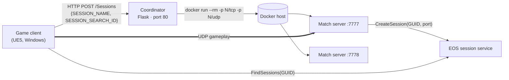
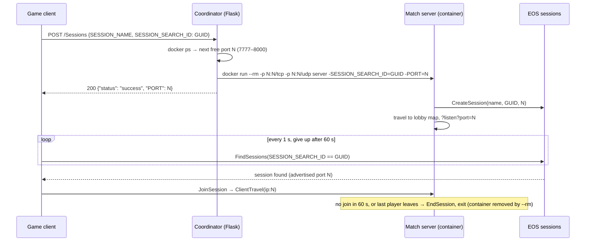
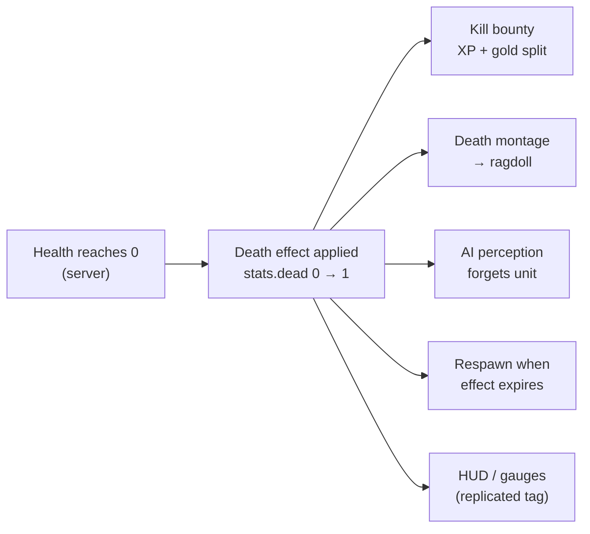

# Crunch

**A 5v5 online action MOBA in Unreal Engine 5 C++, built on the Gameplay Ability System.**
Players sign in with Epic Online Services, create or browse lobbies, draft heroes, and play on a dedicated server that a small Python + Docker orchestrator starts on demand for each lobby.

<!-- TODO: gameplay GIF / screenshot here -->

| | |
|---|---|
| **Codebase** | ≈14,000 lines of C++ in 90 classes, plus a Python/Docker server orchestrator |
| **Engine** | Unreal Engine 5.4 (source build): game, editor, and Linux dedicated-server targets |
| **Netcode** | Dedicated server, server-authoritative; replicated GAS with client-side prediction |
| **Online** | EOS Account Portal login, live session browser, one dedicated server per lobby |
| **Engine systems** | GAS, Enhanced Input, AI Perception, Behavior Trees, Niagara, UMG, Slate |
| **Content** | 2 heroes (2 skins each) · 10 hero abilities · 8 craftable items · lane minions · a moving objective |

Full write-up with diagrams: [`docs/Crunch-Technical-Overview-Full.pdf`](docs/Crunch-Technical-Overview-Full.pdf).

---

## Highlights

- **Servers on demand.** Creating a lobby starts a dedicated server in its own Docker container. The client finds *its* server among many by a GUID it generated itself, so concurrent lobbies never cross wires. → [Matchmaking](#matchmaking-and-dedicated-servers)
- **Server-authoritative GAS.** 10 predicted hero abilities, custom damage and scaling math (MMCs), and gameplay tags as the single source of truth for unit state. → [GAS](#gameplay-ability-system)
- **Animation-driven combat.** Anim notifies sweep chains of mesh sockets on the exact frame they fire, so animators control hit timing and reach without touching code. → [Combat](#combat)
- **One pipeline for players and AI.** Minions share the character base, ability system, and damage math with heroes; a behavior-tree task "presses" ability inputs. → [AI](#ai-and-the-storm-core)
- **Data-driven crafting economy.** A server-authoritative inventory auto-crafts multi-tier recipes; a custom Slate widget lays out and draws the recipe tree. → [Items](#items-and-crafting)
- **Event-driven, not Tick-driven.** Delegates and timers replace `Tick` almost everywhere; per-frame work only runs on short-lived actors while they're active. → [Performance](#performance-model)

---

## Architecture

### Runtime topology



The coordinator runs in a container with the host's Docker socket mounted and launches each match server as a **sibling container**. Each match server ships on a distroless `nonroot` image: no shell, no package manager, no root.

### Class architecture

Two project base classes carry most of the shared machinery. Heroes, minions, and abilities are thin subclasses that Blueprints configure with data assets, gameplay effects, and montages.

```
ACharacter ─► ACCharacter  (ASC + attributes, replicated TeamID, death/respawn/stun/aim reactions)
                ├─► ACPlayerCharacter  (camera, hero attributes, inventory, Enhanced Input)  ◄─ ACPlayerController
                └─► AMinion            (team skins, lane goal, pooled by barracks)          ◄─ ACAIController

UGameplayAbility ─► UCGameplayAbility  (aim traces, socket sweeps, knockback, team checks, stun/level-0 gating)
                      ├─► Crunch:  Combo · UpperCut · Ground Blast · Dash · Tornado
                      ├─► Phase:   Shoot · Blink · Freeze · Laser · Black Hole
                      └─► Passives: GAP_Dead (kill rewards) · GAP_Launched (knockback)
```

- **Two-phase init.** The server's `OnPossess` → `ServerSideInit` sets ASC actor info, base stats, initial effects, and abilities. The owning client's `AcknowledgePossession` → `ClientSideInit` sets actor info only, then builds the HUD. AI pawns initialize from `PossessedBy`.
- **Teams through one interface.** Characters, controllers, projectiles, and targeting actors all implement `IGenericTeamAgentInterface`, so a single `GetTeamAttitudeTowards` call filters hits, AI perception, kill rewards, and objective influence everywhere.
- **Custom trace channels.** Ground-pick traces use a `Target` channel that capsules ignore, so they reach the floor. The camera boom uses a `SpringArm` channel, so the camera doesn't snap in when units brush past.

---

## Matchmaking and dedicated servers

**The problem:** a player who creates a lobby needs a server that exists seconds later and that *only they* can identify, even when several lobbies start at once.

**The solution, a GUID handshake:** the client generates a GUID, sends it with the HTTP request, and the coordinator passes it to the new server process. The server advertises it as a session setting, and the client polls the session service for that GUID. The GUID is the only key shared by the HTTP call and the session search.



| Piece | Implementation |
|---|---|
| **Coordinator** | [`ServerDeploy/coordinator/coordinator/coordinator.py`](ServerDeploy/coordinator/coordinator/coordinator.py): Flask, `POST /Sessions`. Parses `docker ps` port mappings to pick the next free port and launches the container with `--rm`, so finished matches leave nothing behind. A local variant, [`Coordinator/coordinator.py`](Coordinator/coordinator.py), launches editor server processes on incrementing ports for testing without Docker. |
| **Server lifecycle** | [`CGameInstance`](Source/Crunch/Private/Framework/CGameInstance.cpp) detects `NM_DedicatedServer`, reads `-SESSION_NAME`, `-SESSION_SEARCH_ID`, `-PORT` ([`CNetStatics`](Source/Crunch/Private/Network/CNetStatics.cpp)), creates a 10-slot session that advertises all three via `ViaOnlineServiceAndPing`, and opens the lobby as a listen map. A custom [`AGameSession`](Source/Crunch/Private/Network/CGameSession.cpp) tracks players by net ID. |
| **Client flow** | EOS Account Portal sign-in; the session browser refreshes every 2 s and keeps a selection only while that session exists. On join, the advertised port is written into the resolved connect string, which lets many servers share one host. Search and join delegates are unbound as soon as each request finishes. |
| **Lobby → match** | Seamless travel plus `APlayerState::CopyProperties` carry each player's slot and hero pick to the battle map, where the game mode spawns the chosen hero and derives team and start spot from the slot. |

---

## Networking and replication

Shared state replicates as properties with RepNotify; player intent reaches the server through a small set of reliable RPCs. Everything other players need to see is a replicated property or attribute, so **the project uses no multicast RPCs**.

| Server RPCs | Client RPCs | Multicasts | Replicated attributes | Gameplay tags |
|:-:|:-:|:-:|:-:|:-:|
| 9 | 6 | 0 | 18 | 50 |

- **Attributes** use `REPNOTIFY_Always` + `GAMEPLAYATTRIBUTE_REPNOTIFY`, so prediction corrections and HUD delegates fire even when a value arrives unchanged. Cached percentages and growth rates stay server-only.
- **Input during active abilities.** Shoot and UpperCut react to attack press/release while already running. The character raises those events locally for prediction and mirrors them through `Server_SendGameplayEventToSelf`, so the server sees identical input.
- **Inventory** has no replicated properties. The server is authoritative, and the owner's mirror is kept in sync by `Client_ItemAdded` / `Client_ItemRemoved` / `Client_ItemStackCountChanged`, keyed by server-issued `FInventoryItemHandle`s.
- **Ability levels.** After the server spends an upgrade point, `Client_AbilitySpecLevelUpdated` writes the level into the owner's spec and fires `AbilitySpecDirtiedCallbacks`, so cost, cooldown, and level pips refresh immediately.
- **Cues.** Hit sparks run as *local* cues (`UGameplayCueManager::HandleGameplayCue`) on every machine playing the animation, with zero network traffic. Area blasts go through the ASC's `ExecuteGameplayCue`, with the radius passed as the cue magnitude.
- **Where targeting runs.** Line, Around, and Blackhole targeting actors generate target data from the server's own overlaps (`ShouldProduceTargetDataOnServer`). GroundPick runs on the client and sends confirmed data through the standard GAS target-data path.

---

## Gameplay Ability System

Heroes and minions share one [`UCAbilitySystemComponent`](Source/Crunch/Private/GAS/CAbilitySystemComponent.cpp); nearly all game state lives in **attributes and gameplay tags**.

- **Data-driven setup.** On the server, the ASC reads the unit's row from an `FHeroBaseStats` DataTable, applies initial effects, and grants abilities keyed by `ECAbilityInputID`. A CurveTable defines XP thresholds and the level cap. Hero abilities start at level 0 and stay locked (overridden `CanActivateAbility`) until a point is spent; max level 4.
- **Two attribute sets.** [`UCAttributeSet`](Source/Crunch/Private/GAS/CAttributeSet.cpp) holds combat stats; [`UCHeroAttributeSet`](Source/Crunch/Private/GAS/CHeroAttributeSet.cpp) holds progression (strength, intelligence, growth rates, XP, level, upgrade points, gold). A cached health percentage rescales current health when an item or level-up raises the maximum.
- **Custom magnitude calculations.** One MMC applies armor mitigation from attributes captured at application time; another scales any stat by `(Level − 1) × GrowthRate`, so stat growth is configured as data.

```cpp
// MMC_BaseAttackDamage.cpp: AttackDamage captured from the Source, Armor from the Target
GetCapturedAttributeMagnitude(DamageCaptureDef, Spec, EvalParams, AttackDamage);
GetCapturedAttributeMagnitude(ArmorCaptureDef, Spec, EvalParams, Armor);
return -AttackDamage * (1 - Armor / (Armor + 100));   // 100 armor halves damage
```

- **Tags as state.** `stats.dead`, `stats.stun`, `stats.aim`, `stats.focus` drive behaviour. Characters, AI controllers, anim instances, and widgets **subscribe to tag-count changes instead of polling**: stun disables input, aim switches to strafing with a shoulder camera, focus locks movement during channels.
- **Death is a gameplay effect** that grants `stats.dead`. Gaining the tag cancels abilities, plays the death montage, ragdolls, and hides the unit from AI; losing it respawns with full stats. For heroes the respawn timer *is* the effect duration; minions use an infinite effect until their barracks recycles them.
- **Kill rewards.** A server-only passive ([`GAP_Dead`](Source/Crunch/Private/GAS/GAP_Dead.cpp)) triggered by the death event reads the killer from the effect context, pays it 50% of the bounty (200 + 10% of the victim's XP, plus gold), and splits the rest among enemy heroes within 1,000 uu via SetByCaller magnitudes.
- **One knockback path.** Abilities send the target a gameplay event carrying a velocity, and a server-only passive ([`GAP_Launched`](Source/Crunch/Private/GAS/GAP_Launched.cpp)) applies it, for every ability and unit type.



---

## Heroes and abilities

Costs, cooldowns, stuns, and slows are gameplay effects, so balance changes are data changes. The HUD recomputes each ability's cost and cooldown per level from its effects.

| Hero | Ability | Under the hood |
|---|---|---|
| **Crunch** (melee bruiser) | Combo | 4-section montage chained through notify tags; one damage effect per section |
| | UpperCut | Launches caster + targets; combo events keep both airborne with per-section push vectors in local space |
| | Ground Blast | GroundPick targeting with decal preview; radius-scaled cue and camera shake |
| | Dash | Around targeting actor riding a socket; client feeds forward input per frame; damage, stun, radial knockback |
| | Tornado | Up to 4 s channel; damage events emitted by animation at generic damage points |
| **Phase** (ranged caster) | Shoot | Homing projectiles from alternating hands, pre-built effect specs, soft lock-on retargeting |
| | Blink | GroundPick, teleport on an animation event, landing damage + knockback |
| | Freeze | GroundPick area damage plus a slow effect |
| | Laser | Channel with an ongoing mana-cost effect; Line actor reports hits every 0.3 s |
| | Black Hole | Two-stage targeting: place, hold up to 6 s while pulling enemies server-side, detonate with radial knockback |

---

## Combat

Abilities use GAS **local prediction**: the owning client plays montages immediately (`HasAuthorityOrPredictionKey`), while damage, knockback, and spawning run only with authority.

- **Animation-driven hits.** [`AN_SendTargetGroup`](Source/Crunch/Private/Animations/AN_SendTargetGroup.cpp) sphere-sweeps along a chain of mesh sockets (e.g. the path of a fist) on the frame it fires, de-duplicates and team-filters hits, and sends them to the owner as gameplay-event target data.
- **Combos.** Montage notifies open input windows by sending tags like `ability.combo.change.combo02`; the ability takes the tag's last segment as the next section and jumps there if attack is pressed in time.
- **Four custom targeting actors.**

| Actor | Used by | How it works |
|---|---|---|
| [GroundPick](Source/Crunch/Private/GAS/TargetActor_GroundPick.cpp) | Ground Blast, Blink, Freeze, Black Hole | Camera trace on the `Target` channel each tick with a downward fallback; decal preview; on confirm, overlap + friend/foe filter + picked point as extra target data |
| [Line](Source/Crunch/Private/GAS/TargetActor_Line.cpp) | Laser | Sweeps from a hand socket to the aim point every frame, sizes the Niagara beam to the first hostile hit; ends the channel when mana can't pay the drain |
| [Around](Source/Crunch/Private/GAS/TargetActor_Around.cpp) | Dash | Rides a socket through the dash; damages and knocks away each enemy it touches |
| [Blackhole](Source/Crunch/Private/GAS/TA_Blackhole.cpp) | Black Hole | Pulls enemies to its centre every server tick with Niagara link beams; returns captured units + centre for the final blast |

- **Projectiles and lock-on.** Phase's attack spawns a replicated, server-steered homing projectile carrying a pre-built `FGameplayEffectSpecHandle`, so damage uses the caster's stats *at fire time*; lifetime = range ÷ speed. Targeting re-traces every 0.1 s and retargets as soon as the current target gains `stats.dead`.
- **Multi-stage abilities.** Black Hole chains two targeting tasks, unbinds the first montage's end callbacks so the ability outlives that animation, and hands ending over to the hold montage.

---

## AI and the Storm Core

- **Same pipeline as players.** [`BTTask_SendInputToAbilitySystem`](Source/Crunch/Private/AI/BTTask_SendInputToAbilitySystem.cpp) presses an `ECAbilityInputID`, so AI attacks run through exactly the same code path as player attacks.
- **Perception.** Team-filtered sight (1,000 / 1,200 uu, 180°) feeds a blackboard target. A dead target's stimuli are aged to max so it's dropped immediately. The controller pauses its behavior tree and senses while its unit is dead or stunned. Automatic pawn sight registration is off; characters register and unregister themselves.
- **Pooling.** [`MinionBarrack`](Source/Crunch/Private/AI/MinionBarrack.cpp) reuses dead minions before spawning new ones (3 every 5 s). New minions spawn *deferred*, so team and skin are set before `BeginPlay`.
- **Storm Core** ([`StormCore.cpp`](Source/Crunch/Private/Framework/StormCore.cpp)): the objective counts each team's units inside its influence sphere and drives toward the favoured team's goal:

  `w = (n₁ − n₂) / (n₁ + n₂)`  speed `= v_max · |w|`

  On arrival the game mode notifies every player controller; clients disable input, blend the camera to the core, and show the result.

---

## Items and crafting

- **Asset manager.** A custom [`UAssetManager`](Source/Crunch/Private/Framework/CAssetManager.cpp) async-loads heroes and items as primary data assets and builds a **bidirectional crafting graph** (ingredient → recipes, item → ingredients).
- **Inventory** ([`InventoryComponent`](Source/Crunch/Private/Inventory/InventoryComponent.cpp)): all mutations run on the server. A purchase checks gold, then stacks, crafts, or adds. A full inventory still accepts a purchase that *completes* a recipe, and a crafted item can complete the next recipe in the same purchase. Items apply equip or consume effects and can grant abilities, all removed with the item. 6 slots, 4 recipe tiers, 50% sell-back.
- **No-code content.**
    - *New item:* create a `PA_ShopItem` (price, icon, effect, optional ability, stacking, ingredients). It appears in the shop, the tree view, and the inventory automatically.
    - *New hero:* a Blueprint from `ACPlayerCharacter`, a stats row, ability widget rows, and a `PA_CharacterDefination`. The asset-manager scan adds it to hero select.

---

## UI engineering

36 UI classes (UMG + Slate). The interesting ones:

- **Crafting tree** ([`ItemTreeWidget`](Source/Crunch/Private/Widgets/ItemTreeWidget.cpp)): a recursive tidy-tree layout that centres parents over children and re-centres on the selected item. Edges are Hermite splines drawn in `NativePaint` with `FSlateDrawElement::MakeSpline`.
- **Live 3D portraits** ([`RenderActorWidget`](Source/Crunch/Private/Widgets/RenderActorWidget.cpp)): an isolated scene-capture actor far off-map with a show-only list and its own lighting channel, rendering on a 24 fps timer instead of every frame.
- **Material-driven HUD:** cooldown sweeps, castability, level pips, and upgrade glows are dynamic material parameters driven by GAS delegates.
- **Inventory:** drag-and-drop via a custom `UDragDropOperation`; a right-click context menu clamped to the viewport.
- **Lobby:** a replicated `TArray<FPlayerSelection>` on the game state pushed to the UI by RepNotify; the server rejects taken slots and duplicate heroes.

---

## Performance model

Per-frame work is limited to things that move or aim every frame, and each runs only while active. Everything else is a delegate or a timer sized to how fast its result can change.

| Work | Scheduled by | Rate |
|---|---|---|
| Projectile movement, laser sweep, black-hole pull, ground-pick preview | `Tick` on short-lived actors, only while they exist | frame |
| Portrait capture | Timer calling `CaptureScene` manually | 24 fps |
| Lock-on retrace, cooldown display | Timer, only while firing / cooling down | 0.1 s |
| Laser hit report | Timer on the Line actor | 0.3 s |
| Match progress bar | Timer; team counts arrive by delegate | 0.5 s |
| Overhead bar culling | Per-character distance check | 1 s |
| Minion waves | Timer per barracks | 5 s |

Also: minion pooling, soft references for hero classes and icons, and a Storm Core `Tick` that does nothing until a capture starts.

---

## Repository layout

```
Source/Crunch/Private/
  GAS/          ASC, attribute sets, 12 abilities, 4 targeting actors, MMCs, projectile   (~4.6k lines)
  Widgets/      HUD, shop, crafting tree, inventory, lobby, portraits                    (~4.1k)
  Framework/    game instance (session flow), game mode/state, Storm Core, asset manager (~1.5k)
  Inventory/    server-authoritative inventory and crafting                              (~1.0k)
  Player/       player character, controllers, player state, lobby RPCs                  (~1.0k)
  Character/    shared hero/minion base                                                  (~0.7k)
  AI/           AI controller, minions, barracks, BT task                                (~0.6k)
  Animations/   anim instance, hit-detection notifies                                    (~0.3k)
  Network/      session settings, command-line config, game session                      (~0.2k)
Source/*.Target.cs        Crunch (game), CrunchEditor, CrunchServer (Linux dedicated server)
ServerDeploy/             docker-compose.yaml, server/Dockerfile (distroless), coordinator/ (Flask + Dockerfile)
Coordinator/              local coordinator variant (launches editor servers, no Docker)
launchScripts/            launchServer.bat / launchGame.bat for local testing
Config/                   DefaultGame.ini ([Crunch.Net] CoordinatorURL), DefaultEngine.ini (EOS net driver)
docs/                     full technical overview (HTML + PDF)
```

---

## Building and running

**Prerequisites:**
- Unreal Engine **5.4 built from source** (the dedicated-server target requires it) and Visual Studio.
- An EOS product with **two credential sets**, client and server, selected at launch with `-epicapp="GameClient"` / `-epicapp="ServerClient"`.
- Docker, for the containerized deployment.

**Local testing (no Docker):** set `UNREAL_EDITOR` to your `UnrealEditor.exe`, then:
```bat
launchScripts\launchServer.bat   :: -server, fixed SESSION_NAME / SESSION_SEARCH_ID, -PORT=7779
launchScripts\launchGame.bat     :: -game, -TESTING_URL="127.0.0.1:7777"
```
`-TESTING_URL` overrides the host the client connects to; the session's advertised port is still written into it. For the full create-lobby flow without Docker, run the local coordinator ([`Coordinator/coordinator.py`](Coordinator/coordinator.py)), which spawns editor server processes on incrementing ports.

**Containerized:**
1. Package the `CrunchServer` target for Linux into `ServerDeploy/server/server/`.
2. Build and start the stack:
   ```bash
   cd ServerDeploy
   docker compose build      # server image (distroless) + coordinator image (Python 3.9, Flask, Docker CLI)
   docker compose up -d coordinator
   ```
3. Point clients at the coordinator: `[Crunch.Net] CoordinatorURL` in `Config/DefaultGame.ini`, or `-COORDINATOR_URL=<host>` on the command line.

The coordinator listens on port 80 and publishes match servers on 7777–8000 (TCP + UDP), so the host's firewall or security group must allow those ports.

**Packaging notes:** IoStore with Oodle Kraken compression. The VFX and gameplay-cue folders are always cooked, because the cue manager discovers cue notifies by path at runtime and nothing references them directly.

**Debugging:** every ability, targeting actor, and hit-detection notify has a debug-draw toggle for its traces, sweep spheres, and radii. The session flow logs every step from request to travel.

---

## Engineering principles

- **Server authority.** Clients send intent through RPCs and gameplay events; damage, rewards, purchases, upgrades, and spawning all run on the server.
- **Events over Tick.** Tags and attribute delegates drive state changes; periodic work runs on timers sized to the need.
- **Data over code.** Stats, curves, heroes, items, and effects are assets, so new heroes and items need no C++.
- **One path for everyone.** Players, minions, and items activate abilities through the same ASC; every knockback goes through one passive.

## Known limitations

Deliberately listed; these are the next things to fix.

- **Port allocation race.** Two simultaneous `POST /Sessions` requests can parse the same `docker ps` output and pick the same port. Allocation needs a lock or a reservation.
- **No auth on the coordinator.** Anyone who can reach port 80 can start containers, and the coordinator has the host's Docker socket. It needs authentication, rate limiting, and container health checks; Agones or a similar fleet manager is the path to multi-host scaling.
- **Permissive RPC validation.** `_Validate` functions accept every call. They should check that purchases name real shop items, that slot IDs are in range, and that upgrade requests arrive at a sane rate.
- **Synchronous loads.** Character definitions, item icons, and the recipe-graph build still use `LoadSynchronous`; they should move to async streaming.
- **No automated tests.** Automation specs for damage math, crafting chains, and ability-unlock rules would protect the systems most likely to regress during balancing.
